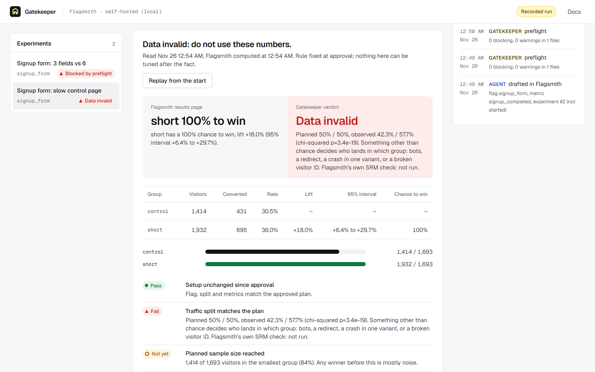

# Experiment Gatekeeper

A CLI, MCP server and console that sit between a coding agent and Flagsmith Experimentation. The agent can draft an experiment, but it can't start one with broken tracking, start one nobody approved, or roll out a "winner" the data doesn't support yet.

**Try it without installing anything:** [recorded console](DEMO_URL) (a real run against self-hosted Flagsmith 2.295.2, replayed step by step). Demo video: VIDEO_URL.

Track 2, AI Agents and Feature Flags.



## Why

Getting an agent to set up an A/B test is now one prompt. Flagsmith's [setup prompt for coding agents](https://docs.flagsmith.com/experimentation/set-up-with-a-coding-agent) creates the flag, metric and experiment and edits your code. That speed makes the old failure modes cheaper to hit. Flagsmith's own [walkthrough of a real test](https://www.wemakedevs.org/blogs/how-to-run-a-real-ab-test-with-flagsmith-experimentation) lists them: events never enabled, a new visitor ID on every request, no default flag handler, and reading an early result as a win. Its example ends with an 84% "winner" whose interval runs from -14% to +44%, and the author decides to keep it running. Gatekeeper turns those judgement calls into checks the agent can't skip.

## What it does

```
draft ──> preflight ──> person approves ──> start ──> verdict ──> person approves ──> roll out
 agent     code scan     terminal / console    agent    stats gate   terminal / console      agent
```

1. **Preflight** scans the app (Python and JavaScript) for nine mistakes that make Flagsmith record wrong or zero data, then checks the live Flagsmith setup (variation keys, metric event names). Each finding has file, line, why it matters and the fix. Blocking findings stop the experiment from being approved.
2. **Plan** fixes the sample size and the decision rule before any data exists (two-proportion power calculation; ship at 95% chance to win and only after the planned sample).
3. **Approval** is the only step an agent can't do. There is no approve tool in the MCP server; `gk approve` refuses to run without an interactive terminal; the console needs a one-time token printed in your terminal. Approvals are signed and bound to a fingerprint of the live Flagsmith setup, so if anyone changes the split, variations or metric afterwards, `start` is refused.
4. **Verdict** reads Flagsmith's results and applies the rule fixed at approval: `ship`, `drop`, `keep_running` or `invalid`, with every check spelled out. It recomputes the sample ratio mismatch test against the approved split, counts how often results were read before the planned sample, and refuses winners below the bar.
5. **Rollout** completes the experiment in Flagsmith with the winning variation, again only after a person approves.

## Results

All numbers come from `eval/results.json` and `demo/` runs; nothing below is typed by hand.

**Preflight against the model alone.** 22 small apps (Python, Flask, a batch job and browser JavaScript) with 23 planted bugs and 5 clean controls (`eval/make_cases.py`). The baseline is a fresh Claude Sonnet agent given Flagsmith's official setup prompt, the answers to its questions, and an explicit request to list every instrumentation problem. Case folders were renamed so the names didn't give the bugs away.

| | bugs caught (of 23) | false alarms on clean apps (of 5) |
|---|---|---|
| Model with the official prompt | 19 | 0 |
| Gatekeeper preflight | 23 | 0 |

| Rule | planted | model with official prompt | Gatekeeper |
|---|---|---|---|
| G1 events not enabled | 5 | 5 | 5 |
| G2 no default handler (warning) | 2 | 0 | 2 |
| G3 new visitor ID per request | 5 | 4 | 5 |
| G4 different identifiers | 3 | 2 | 3 |
| G5 script exits before flush | 1 | 1 | 1 |
| G6 events sent to Cloud | 5 | 5 | 5 |
| G9 flag read before identify() | 2 | 2 | 2 |

We wrote the corpus and the rules, so Gatekeeper's score here is expected; read it as "the rules do what they say". The useful number is the baseline: even when asked directly, the model missed 4 of 23. It missed both missing-default-handler warnings, one mixed-up identifier and one new-ID-per-request bug.

**End to end on real Flagsmith** (self-hosted 2.295.2, Flagsmith database as the warehouse, simulated visitors, recorded in the [console replay](DEMO_URL)):

| Run | Visitors per group | Flagsmith's results page | Gatekeeper |
|---|---|---|---|
| Early read | control 181, short 219 | 44% chance to win, lift -2.3% | `keep_running`: below the planned 1,693 per group; the early look is logged |
| Planned sample | control 1,825 (30.4% signed up), short 1,814 (33.5%) | 97.2% chance to win, lift +10.2% (interval -0.3% to +20.7%) | `ship short`; after a person approved, Gatekeeper completed the experiment in Flagsmith with `short` |
| Slow control page | control 1,414, short 1,932 (42.3% / 57.7% against a 50/50 plan) | 99.9% chance to win (shown as 100%), lift +18.0%, no SRM result | `invalid`: split mismatch, chi-squared p = 3.4e-19; rollout is blocked |

**Something we found in Flagsmith.** The setup prompt adds variations with `--weight 0` and sets the split on the experiment's rollout. Flagsmith's built-in SRM check reads the split from the environment default, sees a 0% variation and skips the test, so the results page reports no SRM result even when the split is badly off. Gatekeeper checks against the split that was approved, which is why it catches the slow-page scenario above. (Flagsmith marks this as a TODO in `experimentation/services.py`, `_expected_variant_shares`.)

## Quick start

Requires Python 3.11+ and a Flagsmith instance with Experimentation (Cloud, or self-hosted with `EXPERIMENTATION_ENABLED=true`).

```bash
pip install -e ".[demo]"
export FLAGSMITH_API_KEY=...            # Organisation > API keys (Cloud) or a user token (self-hosted, with FLAGSMITH_AUTH_SCHEME=Token)
export FLAGSMITH_ENVIRONMENT=...        # environment key
export FLAGSMITH_API_URL=https://api.flagsmith.com/api/v1/   # or your instance

gk preflight demo/signup_broken         # see the problems
gk draft --name "Signup form" --flag signup_form --control control --variant short=short \
  --event signup_completed --hypothesis "3 fields beat 6" --baseline 0.30 --mde 0.15 --code demo/signup_fixed
gk request signup-form
gk approve signup-form                  # a person, in a terminal
gk start signup-form
gk verdict signup-form
gk serve                                # the console
```

**Use it from Claude Code (MCP):**

```bash
claude mcp add gatekeeper -- gk mcp
```

Then ask: "Set up an A/B test of the 3-field signup form with Gatekeeper." Tools: `preflight`, `plan`, `draft_experiment`, `request_start_approval`, `start_experiment`, `read_verdict`, `request_ship_approval`, `ship_experiment`, `status`.

**Replay without Flagsmith:** `gk serve --replay gatekeeper/static/replay.json`.

**Run the demo on your own machine:** start a self-hosted Flagsmith with `EXPERIMENTATION_ENABLED=true`, run `python demo/bootstrap_local.py --api http://localhost:8000 > .env.local`, load it, then `python demo/record_run.py`.

## How Flagsmith is used

| Flagsmith part | Used for |
|---|---|
| Admin REST API | create the multivariate flag with keyed variations, the metric and the experiment (unstarted); read the experiment, its rollout and metrics for the fingerprint; start; refresh and read results; complete with the rollout decision |
| Warehouse connection API | the demo uses the self-hosted "Flagsmith database" warehouse |
| Python SDK | the demo app records exposures with `get_experiment_flag` and conversions with `track_event` |
| Results payload | lift, credible interval and chance to win come from Flagsmith's Bayesian engine; Gatekeeper adds the gate on top |
| MCP | Gatekeeper is itself an MCP server, so the agent drives Flagsmith through it instead of the raw API |

## Preflight rules

| Rule | Catches | Checked in |
|---|---|---|
| G1 | events not enabled (`enable_events` / `enableEvents`) | code |
| G2 | no default flag handler (warning) | code |
| G3 | a new random visitor ID per request | code |
| G4 | conversion sent under a different identifier than the exposure | code |
| G5 | short script exits with events still buffered | code |
| G6 | self-hosted API URL but events still sent to Cloud | code |
| G7 | variation without a key (records no exposures) | Flagsmith |
| G8 | metric event name not sent by the code (case-sensitive) | Flagsmith + code |
| G9 | browser SDK reads the experiment flag before `identify()` | code |

Statistical thresholds are frozen in [DESIGN.md](DESIGN.md).

## Limits

- All traffic in the demo is simulated by `demo/traffic.py` and labelled as such. No result here is a claim about real users.
- Preflight is static analysis with heuristics. It reads Python with the `ast` module and JavaScript with patterns, so unusual code can slip past it.
- An agent with unrestricted shell access on your machine could read the approver key in `~/.gatekeeper/`. The gate is designed for agents working through MCP or a sandboxed shell; keep the key out of the agent's reach.
- Flagsmith Experimentation is in beta, and results refresh at most once every five minutes.
- Tested on Windows against self-hosted Flagsmith 2.295.2. The Cloud API paths are the same, but we did not run against Cloud.

## AI use

Built with AI coding assistants. The rules, the statistics and the approval design were checked by hand, and the tests in `tests/` cover each rule and each verdict.

## License

MIT
